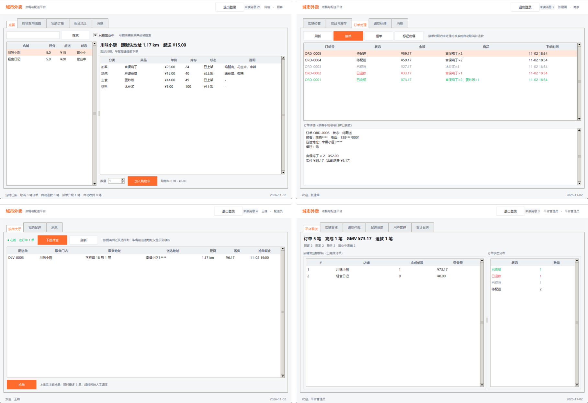

\begin{titlepage}
\centering
\vspace*{3.2cm}

{\sffamily\fontsize{24}{30}\selectfont 实验三\par}
\vspace{0.8cm}
{\sffamily\fontsize{30}{36}\selectfont 软件实现与构建实验报告\par}
\vspace{1.4cm}
{\Large 城市外卖点餐与配送平台\par}
\vspace{0.3cm}


\vspace{3.2cm}
\begin{tabular}{rl}
项目名称： & 城市外卖点餐与配送平台 \\
学\hspace{2em}号： & 241220075 \\
姓\hspace{2em}名： & 赵力丹 \\
实现语言： & Python 3.14 + Tkinter\\
交付内容： & 可运行代码 · 50 余个源文件 · 7 张 UML 图 · 本报告 \\
\end{tabular}

\vfill

\end{titlepage}

\tableofcontents
\newpage

# 项目概述

本实验把实验二的设计落成可运行的桌面应用。系统覆盖顾客点餐、商家接单出餐、骑手抢单配送、平台监管与退款仲裁四条业务线，四类角色共用同一个程序，登录后按账号角色进入对应工作台。数据保存在本地 JSON 文件中，支付、地图与短信均为模拟实现（REQ-024），不依赖外部服务。

| 项目 | 说明 |
| --- | --- |
| 运行环境 | Windows 11，Python 3.14.7|
| 界面技术 | Tkinter 9.0，ttk 主题，单进程四端合一 |
| 数据存储 | JSON 文件，原子替换写入，主键持久化计数 |
| 启动方式 | `python run.py`，或 `python -m app.cli demo` 运行无界面演示 |
| 质量门槛 | `unittest` 34 项测试全部通过；`pylint app` 10.00/10 |

代码按 `ui → services → repository → domain` 分层，入口 `run.py` 只负责启动界面；`app/container.py` 统一装配数据库、仓储与服务，界面层不直接访问存储。这一结构使替换存储、增加角色或新增业务规则时，改动被限制在单一层内。

# 从 UML 到代码

## 转换方法

实验二交付了类图、组件图、部署图、状态图、活动图、时序图和用例图。转换时先固定"图 → 代码单元"的对应规则，再逐层填充，避免边写边改模型。

| UML 元素 | 代码落点 | 规则 |
| --- | --- | --- |
| 类图的类 | `app/domain/models.py` 的 dataclass | 一个类一个 dataclass；属性即字段，方法只保留与自身状态相关的行为 |
| 角色继承 | `User` → `Customer`/`Merchant`/`Rider`/`Admin` | 用继承而不是 `role` 字段分支表达权限差异 |
| 枚举 | `app/domain/enums.py` | 状态、角色、错误类型全部用 `Enum`，中文展示名放在 `label` |
| 关联与组合 | 对象内保存对方主键；组合对象内嵌列表 | 订单持有 `OrderItem` 列表，跨聚合只存 `store_id`、`customer_id` |
| 状态图 | `OrderStateMachine` 的迁移表 | 11 个状态、23 条迁移集中声明，非法迁移统一报错 |
| 时序图 | `OrderService`、`PaymentService`、`DeliveryService` 的方法 | 一次消息对应一个服务方法，参与者对应服务对象 |
| 活动图 | 服务方法内的校验与异常分支 | 判定节点对应 `if` + 项目自定义异常 |
| 组件图 | `app/domain`、`app/repository`、`app/services`、`app/ui`、`app/jobs` | 组件即包，依赖只允许自上而下 |
| 部署图 | 单机进程 + JSON 文件 | 桌面应用不需要网络节点，第三方支付以适配器模拟 |
| 用例图 | 四端视图的标签页与按钮 | 一个用例对应一个可点击入口，权限由服务层再次校验 |

## 分层与依赖装配

```text
run.py → app.ui（登录、顾客、商家、骑手、管理员视图）
           ↓ 只依赖 AppContext
        app.services（订单、支付、配送、退款、统计、通知、审计）
           ↓
        app.repository（通用仓储 + JSON 数据库）
           ↓
        app.domain（实体、枚举、状态机、计价）
```

依赖方向单向，服务之间不形成环：订单、配送、退款共同依赖 `OrderLifecycle` 完成状态迁移，而不是互相调用。`app/jobs/scheduler.py` 只调用服务层公开方法，界面定时器与命令行演示共用同一套超时检查。

## 订单状态机的落地

状态图是本次实现的核心约束。11 个状态与 23 条迁移写入 `app/domain/state_machine.py` ，所有迁移必须经过 `OrderLifecycle.transition`：校验起点与终点、追加状态流水、写入审计与通知，再统一持久化。服务层不直接给 `order.status` 赋值，因此"未支付就送达""已退款又接单"这类非法流转在测试中可稳定复现。

退款另有一条小状态机（待处理 → 同意/驳回/超时自动同意/平台仲裁）。退款单独立成实体并保存 `status_before_refund`，驳回时据此精确恢复订单原状态。

## 对实验二设计的调整

实现过程中有五处设计与代码不完全一致，均已在 `docs/design-mapping.md` 中记录：

| 调整 | 原因 |
| --- | --- |
| 新增 `OrderLifecycle` | 订单、配送、退款都要迁移状态，抽出来后消除服务间循环依赖 |
| 新增 `app/jobs/scheduler.py` | 超时兜底不应绑定在界面定时器上，命令行演示也要能复用 |
| 配送单独立于订单 | 配送异常后需要保留旧任务并生成新任务，一笔订单可对应多个配送单 |
| 退款单保存申请前状态 | 驳回退款时要恢复到"待配送"或"配送中"，不能一律回到固定状态 |
| 四端合一而不是四个程序 | 实验三桌面应用，同一进程按角色切换视图便于运行与测试 |


# 关键实现

## 领域模型与持久化

金额统一使用 `Decimal`，避免浮点误差；订单项保存下单时刻的单价快照，商家改价不影响历史订单。JSON 存储通过 `_type` 字段区分 `User` 子类，通过 `__enum__`、`__decimal__`、`__datetime__` 标记还原特殊类型。每次保存先写临时文件再原子替换，主键由持久化计数器生成（`ORD-0001`、`DLV-0001`），重启后不重号。

## 业务规则

- **超时兜底**：支付 15 分钟、接单 5–20 分钟、退款 10 分钟、派单超时升级、送达 24 小时自动收货，由调度器每 2 秒检查一次。
- **幂等**：结算携带幂等键，重复提交返回同一订单，不重复扣库存；演示脚本使用时间戳键，因此可反复运行。
- **配送**：3 km 服务半径，运费 = 5 元起步 + 1 元/km；取餐前对骑手隐藏完整门牌与电话，取餐后展示。
- **退款**：商家超时未处理自动同意；平台可仲裁并判定责任方；退款成功后同步关闭配送单、释放库存并把任务移出骑手列表。

## 界面

界面使用 ttk 的 Notebook + Treeview + Panedwindow，登录后按角色构建工作台。所有操作经 `BaseView.guard` 包装：服务层异常转为状态栏提示，避免弹窗堆叠或界面崩溃。顾客端五个标签页、商家端五个、骑手端三个、管理员端六个，共用 `MessagePanel`、`ChoiceDialog` 等组件。

# 大模型辅助开发

## 协作流程

采用"需求 → 设计约束 → 接口与存根 → 实现 → 验证"的分解方式，而不是一次性生成整个项目：

1. 每轮任务附带分层约定、实验二类图与状态图要点、REQ 编号、命名与持久化规则；
2. 按领域 → 仓储 → 服务 → 定时任务 → 界面分五批生成，每批通过测试后再进入下一层；
3. 先确定方法签名、异常类型与返回结构，再填充实现，减少接口漂移；
4. 生成后立即执行 `compileall`、`unittest`、命令行演示与界面测试；
5. 人工逐行阅读生成结果，修复单独提交并标注 `[人工修改]`。

Git 上每个批次对应一个特性分支，测试通过后以 `--no-ff` 合入 `main`。提交信息用 `[AI 生成]` 与 `[人工修改]` 区分来源，便于回溯"哪部分由模型生成、哪部分经过人工修正"。

## 大模型承担的工作

| 阶段 | 生成内容 |
| --- | --- |
| 领域层 | 18 个实体数据类、角色继承、枚举与中文标签、状态迁移表、计价函数 |
| 数据访问层 | JSON 原子存储、通用仓储、类型编解码器、13 类专用仓储 |
| 业务服务层 | 登录锁定、店铺菜单、购物车、结算幂等、支付、配送、退款仲裁、统计、通知、审计 |
| 定时任务 | 支付超时、接单超时、退款自动同意、派单升级、自动收货 |
| 界面层 | 登录注册、四端视图、主题与通用组件、模态对话框 |
| 测试 | 多项单元/集成测试及测试数据构造 |
| 工程化 | pylint 清理建议、README 与设计映射文档初稿、截图脚本 |

## 不符合预期的输出与处理

| # | 现象 | 原因与处理 |
| --- | --- | --- |
| 1 | 订单仓储用 `store_id` 当主键，同店订单互相覆盖 | 通用仓储按属性优先级取主键；改为按字段声明顺序取 `order_id`，并补充嵌套订单测试 |
| 2 | `autosave=False` 时显式保存不落盘 | 保存逻辑误用了 autosave 开关；显式 `save()` 始终写盘 |
| 3 | 演示数据初始化抛"管理员不能自助注册" | 种子数据复用了用户注册接口；管理员改为系统直接插入 |
| 4 | 命令行演示下单低于起送价 | 演示数量不足；调整数量并打印校验信息 |
| 5 | 命令行打印的是迁移前的旧状态 | 脚本仍引用旧对象；统一使用返回值或重新查询 |
| 6 | 重派后取餐报"配送中 → 配送中"非法迁移 | 取餐逻辑无条件迁移；改为仅在"待配送"时迁移，补充异常→重派→取餐→送达测试 |
| 7 | 骑手详情对手机号调用了地址脱敏 | 混用 `mask_detail` 与 `mask_phone`；按字段选择脱敏函数 |
| 8 | 多处未使用导入、超长行、`type(None)` 写法 | pylint 清理，改用 `types.NoneType`，抽取共用消息面板，最终 10.00/10 |
| 9 | 演示第二次运行报"已完成订单不能支付" | 固定幂等键复用了旧订单；改为时间戳键，保留同次运行的幂等断言 |
| 10 | 退款订单仍留在骑手任务列表 | 退款未关闭配送单；新增 `DeliveryStatus.CANCELLED` 与 `cancel_for_order`，并补充断言 |
| 11 | Windows 偶发 `PermissionError` 替换数据文件 | 杀毒/索引服务短暂占用；原子替换增加退避重试 |

处理原则是不直接接受看似合理的生成结果，先用测试或命令复现，再改实现，最后重跑全部测试与演示。第 10、11 项是截图与重复运行阶段才暴露的问题，说明跑通不等于状态一致，验收时需要同时核对界面与数据。

## 提示词与工程化经验

- 明确"只改哪些文件、不要改哪些层"，避免模型跨层重写；
- 给出具体数值（15 分钟、5–20 分钟、3 km、5 元 + 1 元/km），而不是"合理设置超时"；
- 要求异常必须使用项目已有类型、状态迁移必须经过 `OrderLifecycle`，减少自造 API；
- 要求同时生成失败分支测试（重复结算、越权、库存回滚、超时）；
- 界面任务提供控件结构与交互约定，并要求所有操作经 `BaseView.guard` 兜底。


# 编译与运行结果

## 自动化测试

```text
> python -m unittest discover -s tests -t .
..................................
Ran 34 tests in 7.892s
OK
```

| 测试文件 | 数量 | 覆盖内容 |
| --- | ---: | --- |
| `test_domain.py` | 10 | 合法/非法状态迁移、计费、库存与售罄、购物车单店与数量 |
| `test_repository.py` | 4 | 用户子类往返、订单嵌套持久化、主键计数、地址 |
| `test_order_flow.py` | 14 | 全流程、幂等、支付失败回滚、超距、越权、接单超时、退款同意/驳回、配送异常与重派、登录锁定 |
| `test_scheduler.py` | 6 | 支付超时、接单超时、退款自动同意、派单升级、自动收货、空跑 |

## 命令行演示

从干净数据开始执行 `reset`、`seed`、`demo`，输出节选：

```text
=== 1. 顾客加购并提交订单（幂等） ===
订单号：ORD-0001，应付：73.17 元
重复提交返回：ORD-0001（reused=True）

=== 2. 支付 → 商家接单 → 出餐 → 骑手取送 → 确认收货 ===
最终状态：已完成，取餐/送达时间：True/True

=== 3. 退款流程：顾客申请 → 商家同意 ===
退款单：RFD-0001（已同意）
订单状态：已退款，支付流水状态：已退款

=== 4. 模拟支付失败与库存回滚 ===
订单状态：已取消（支付失败）
库存：100 → 100

=== 5. 经营统计 ===
今日订单 3 笔，完成 1 笔，营业额 73.17 元，退款 1 笔，评分 5.0
平台总订单 3 笔，GMV 73.17 元，活跃店铺 2 家
```

## 界面运行

`python run.py` 启动后进入登录页，演示验证码为 `123456`，可一键填入顾客、两家商家、骑手、管理员账号。图 1 为四端主界面。

{width=10.5cm}

# Git 版本管理

## 分支策略与提交记录

本地仓库按"一个功能一个分支"组织：`feat/*` 承载新功能，`fix/*` 承载缺陷修复，`chore/*` 与 `docs/*` 承载规范清理和文档。分支完成后以 `--no-ff` 合入 `main`，保留合并节点，能够看出每个功能从哪一批提交进入主干。提交信息前缀 `[AI 生成]` 或 `[人工修改]` 标明来源。

| 分支 | 内容 |
| --- | --- |
| `feat/domain-model` | 领域模型、枚举、状态机、计价 |
| `feat/persistence` | JSON 原子存储、通用仓储、编解码 |
| `feat/services` | 业务服务与依赖装配 |
| `feat/jobs` | 定时任务与超时兜底 |
| `feat/ui` | 登录与四端桌面界面 |
| `chore/code-quality` | pylint 清理与共用组件 |
| `fix/demo-repeatability` | 命令行演示可重复执行 |
| `docs/engineering` | 设计映射、AI 记录、测试记录 |
| `fix/refund-delivery-consistency` | 退款后关闭配送单 |
| `fix/storage-retry` | Windows 原子替换重试 |
| `chore/report-artifacts` | 报告截图与验证记录 |
| `docs/lab3-report` | 报告源文件与 PDF |
| `chore/package-script` | 提交包打包脚本与 README 同步 |

截至报告撰写时，`main` 共 27 次提交、已合并 13 个特性分支。主干历史如下（节选）：

```text
*   [AI 生成] 合入报告截图与验证记录
|\
| * [AI 生成] 补充报告用界面截图脚本与验证记录
|/
*   [人工修改] 合入存储重试修复
|\
| * [人工修改] 原子替换失败时短暂重试，兼容 Windows 文件占用
|/
*   [人工修改] 合入退款与配送状态一致性修复
|\
| * [人工修改] 退款成功后关闭配送单并清理骑手任务
|/
*   [人工修改] 合入工程文档分支
|\
| * [AI 生成] 补充实验三工程文档
...
```

## 远程仓库托管

代码托管平台为 GitHub。远程仓库采用"本地 `main` 为唯一集成分支、特性分支合入后推送"的方式
```text
> git remote add origin https://github.com/<账号>/city-takeout.git
> git push -u origin main
> git push origin --all
```

说明：本次实现与测试在未配置 GitHub 账号凭据的本地环境中完成，仓库根目录的 `.gitignore` 已排除 `data/*.json`、`__pycache__` 等运行产物。

